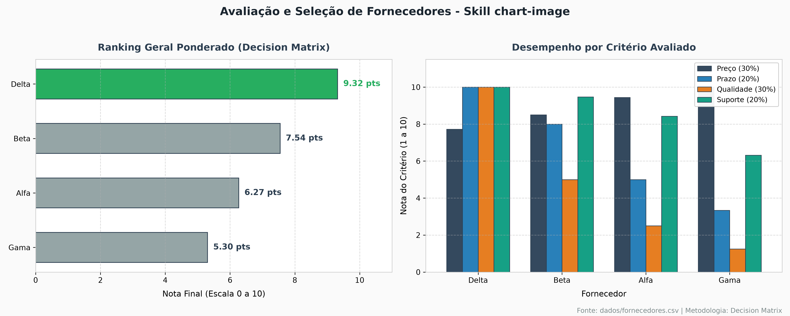
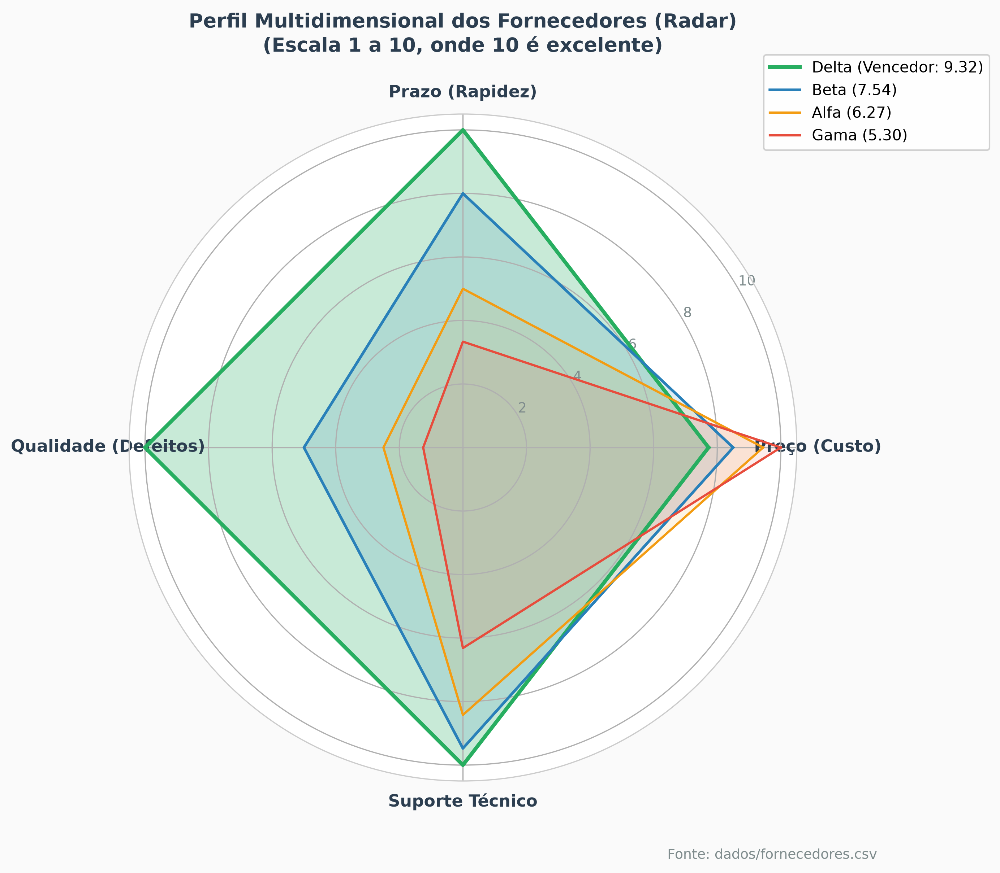
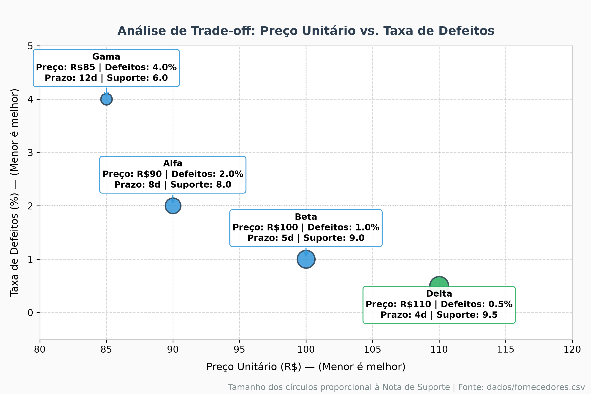

# Relatório de Avaliação de Fornecedores (Decision Matrix & Chart Image)

Este relatório foi gerado seguindo as diretrizes das skills **decision-matrix** e **chart-image**.

## 1. Dados Originais dos Fornecedores

| Fornecedor | Preço Unitário (R$) | Prazo (Dias) | Defeitos (%) | Nota de Suporte |
|---|---|---|---|---|
| Alfa | 90 | 8 | 2.0% | 8.0 |
| Beta | 100 | 5 | 1.0% | 9.0 |
| Gama | 85 | 12 | 4.0% | 6.0 |
| Delta | 110 | 4 | 0.5% | 9.5 |

## 2. Critérios e Pesos Utilizados

- **Preço Unitário (30%):** Menor valor é melhor.
- **Qualidade / Defeitos (30%):** Menor taxa de defeitos é melhor.
- **Prazo de Entrega (20%):** Menor tempo é melhor.
- **Suporte Técnico (20%):** Maior nota é melhor.

## 3. Notas Normalizadas (Escala de 1 a 10)

| Fornecedor | Score Preço | Score Prazo | Score Defeitos | Score Suporte | **Nota Final Ponderada** | **Posição** |
|---|---|---|---|---|---|---|
| **Delta** | 7.73 | 10.00 | 10.00 | 10.00 | **9.32** | 1º |
| **Beta** | 8.50 | 8.00 | 5.00 | 9.47 | **7.54** | 2º |
| **Alfa** | 9.44 | 5.00 | 2.50 | 8.42 | **6.27** | 3º |
| **Gama** | 10.00 | 3.33 | 1.25 | 6.32 | **5.30** | 4º |

## 4. Conclusão e Recomendação

**Fornecedor Recomendado:** **Delta** com nota ponderada de **9.32**.

- **Pontos Fortes:** Nota 10 em agilidade (4 dias), qualidade (0.5% defeitos) e suporte técnico (9.5).
- **Trade-off:** Preço ligeiramente superior (R$ 110), amplamente compensado pela confiabilidade operacional.

## 5. Análises Visuais de Apoio à Decisão

### Gráfico 1: Ranking e Comparativo por Critério

### Gráfico 2: Perfil Multidimensional (Radar)

### Gráfico 3: Trade-off Custo vs. Qualidade

